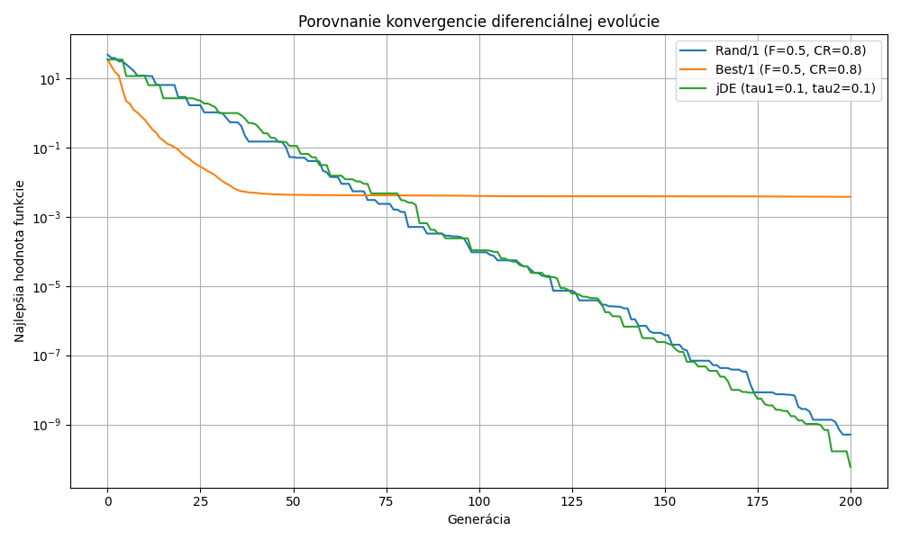

# Protokol – Diferenciálna evolúcia

## Cieľ
Cieľom bolo implementovať a porovnať tri varianty diferenciálnej evolúcie: Rand/1, Best/1 a jDE.

## Nastavenie experimentu
- Testovacia funkcia: Sphere, \(f(x)=\sum_{i=1}^{D} x_i^2\)
- Počet dimenzií: 10
- Rozsah premenných: \([-5.12, 5.12]\)
- Veľkosť populácie: 40
- Počet generácií: 200
- Rand/1 a Best/1: \(F=0.5\), \(CR=0.8\)
- jDE: \(\tau_1=\tau_2=0.1\), počiatočné \(F=0.5\), \(CR=0.9\)

## Výsledky

| Variant | Najlepšia hodnota funkcie |
|---|---:|
| Rand/1 | 5.05673278969 × 10⁻¹⁰ |
| Best/1 | 0.00377733179655 |
| jDE | 5.8735974439 × 10⁻¹¹ |

## Graf konvergencie

## Záver
Všetky tri varianty výrazne znížili hodnotu funkcie Sphere, ktorej globálne minimum je 0. Najlepšiu hodnotu dosiahol jDE, za ním nasledoval Rand/1. Best/1 dosiahol v tomto behu horší výsledok. Výsledky ukazujú, že úspešnosť variantov závisí od ich stratégie a nastavenia parametrov.
